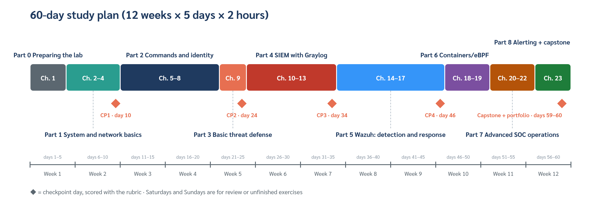

**English** · [ภาษาไทย](study-plan.th.md)

# 60-day study plan (2 hours/day)

5 days a week, 12 weeks in total. The formatted Thai learner guide (.docx) with illustrations is built from the same data as this file.



## Rubric

| Area | 4 Excellent | 3 Pass | 2 Needs work | 1 Not yet |
| --- | --- | --- | --- | --- |
| Works (40%) | Every item passes and can be rerun (idempotent) | Every item in the pass criteria passes | Some items pass; needed help | The system does not work |
| Evidence and verification (25%) | Output, times, and an explanation of what it proves | All the required output | Partial, or the machine/time is not stated | No evidence |
| Security (20%) | Least privilege, no leaked secrets, reversible, and extra protections added on your own | SELinux/firewall not disabled; no secrets in configs or the repo | One risky spot, such as file permissions that are too wide | A protection layer disabled, or a secret leaked |
| Understanding and communication (15%) | Explains the reasons and the alternatives; can teach others | Explains what was done and why | Can only explain the steps | Cannot explain |

Score = Σ(level ÷ 4 × weight). Pass at ≥ 75% with no area at level 1. Level 1 in Security is an immediate fail.

## Part 0 Preparing the lab

### Day 1 · Chapter 1 — Enable Hyper-V and create pve-01

**Goal:** The Windows machine can run nested virtualization and has a pve-01 VM that boots the Proxmox installer

**Theory**
- Type 1 vs type 2 hypervisors, and why the lab is nested two levels deep (Hyper-V → Proxmox → Rocky)
- Nested virtualization requires ExposeVirtualizationExtensions on the first-level VM
- Rocky Linux 10 requires an x86-64-v3 CPU, so VMs must use CPU type host

**Steps**
1. Check CPU, RAM and disk space against the Hardware table in chapter 1
2. Enable the Hyper-V feature and restart
3. Download the Proxmox VE ISO and the lab files
4. Create pve-01 with New-ProxmoxLabHost.ps1

**Key commands** (Windows · PowerShell)
```bash
Enable-WindowsOptionalFeature -Online -FeatureName Microsoft-Hyper-V-All -All
.\windows\New-ProxmoxLabHost.ps1 -IsoPath D:\ISO\proxmox-ve_9.2-1.iso -VMPath D:\Hyper-V
Get-VMProcessor pve-01 | Format-List ExposeVirtualizationExtensions
```

**Exercises**
- Explain in your own words why a Hyper-V checkpoint of pve-01 is not suitable for rolling back individual machines

**Pass criteria**
- [ ] ExposeVirtualizationExtensions = True
- [ ] pve-01 boots into the Proxmox installer

**Evidence:** Screenshot of the Get-VMProcessor output

Further reading: Chapter 1 Building the Lab: Proxmox VE on Hyper-V and Rocky Linux 10

### Day 2 · Chapter 1 — Install Proxmox VE and the lab network

**Goal:** Proxmox is usable, with vmbr1 (192.168.10.1/24) and NAT out to the internet

**Theory**
- A Linux bridge is a virtual switch: vmbr0 connects to the uplink, vmbr1 is the lab network
- NAT (masquerade) lets VMs reach the internet through the IP of pve-01
- The no-subscription repository for the lab

**Steps**
1. Install Proxmox VE from the ISO, then remove the ISO
2. Copy the repo to pve-01 and set up the repositories
3. Create vmbr1 and NAT with the script
4. Create an ed25519 SSH key on Windows

**Key commands** (pve-01 · root)
```bash
bash pve-repos.sh
bash pve-setup-network.sh
ip -br addr show vmbr1
nft list ruleset | grep -i masquerade
```

**Exercises**
- Draw the lab network by hand, marking the bridges, IPs and the direction of NAT

**Pass criteria**
- [ ] The Web UI at https://pve-01:8006 opens
- [ ] vmbr1 has IP 192.168.10.1/24

**Evidence:** Output of ip -br addr and the diagram you drew

Further reading: Chapter 1 Building the Lab: Proxmox VE on Hyper-V and Rocky Linux 10

### Day 3 · Chapter 1 — Rocky Linux 10 golden image and template

**Goal:** A clean rocky10-tpl template (VM 9000) ready to clone

**Theory**
- A golden image is a reference machine with machine-specific data removed
- Data to remove: machine-id, SSH host keys, NetworkManager profiles
- cloud-init configures a new machine at first boot from a Proxmox drive

**Steps**
1. Download the Rocky 10 Minimal ISO on pve-01
2. Create VM 9000 and install Rocky with the temporary IP .99
3. Check the version, LVM and SELinux (Lab 1)
4. Run golden-prep.sh and convert to a template

**Key commands** (pve-01 · root)
```bash
bash pve-get-iso.sh https://download.rockylinux.org/pub/rocky/10/isos/x86_64/<minimal.iso>
bash pve-create-golden.sh
bash pve-make-template.sh
qm config 9000 | grep -E "^(template|cpu|ide2)"
```

**Exercises**
- Before running golden-prep.sh, note the machine-id; after cloning on day 4, check that every machine got a new value

**Pass criteria**
- [ ] VM 9000 is a template
- [ ] cpu: host
- [ ] getenforce = Enforcing (before converting)

**Evidence:** Output of qm config 9000

Further reading: Chapter 1 Building the Lab: Proxmox VE on Hyper-V and Rocky Linux 10

### Day 4 · Chapter 1 — Clone 6 machines, snapshots and day-to-day use

**Goal:** The 7-machine lab passes Test-SocLab.ps1 and has the ch01-base snapshot

**Theory**
- How a full clone differs from a linked clone
- Snapshot vs backup: a snapshot lives on the same storage as the VM
- Boot order follows the startup order (ipa-01 comes up first)

**Steps**
1. Clone every machine from lab-hosts.csv
2. Run Initialize-SocLab.ps1 from Windows
3. Check with Test-SocLab.ps1
4. Create the ch01-base snapshot
5. Try starting and stopping machines with pve-lab-power.sh

**Key commands** (pve-01 · root)
```bash
bash pve-clone-lab.sh
bash pve-snapshot.sh ch01-base
bash pve-snapshot.sh --list
bash pve-lab-power.sh status
```

**Exercises**
- Do the "rollback test" exercise at the end of chapter 1 with lab-linux-02

**Pass criteria**
- [ ] Test-SocLab.ps1 shows no FAIL (exit code 0)
- [ ] machine-id is unique on every machine
- [ ] The ch01-base snapshot exists on all 6 machines

**Evidence:** Screenshot of the Test-SocLab.ps1 result

Further reading: Chapter 1 Building the Lab: Proxmox VE on Hyper-V and Rocky Linux 10

## Part 1 System and network basics

### Day 5 · Chapter 2 — NetworkManager, DNS search and FQDN hostnames

**Goal:** Every machine has an FQDN that resolves to its real IP, not 127.0.0.1

**Theory**
- NetworkManager separates devices (cards) from connections (profiles of settings)
- Name resolution order: /etc/hosts → DNS, per /etc/nsswitch.conf
- FreeIPA needs an FQDN that points to the real IP; cloud-init maps the FQDN to 127.0.0.1, so it must be fixed

**Steps**
1. Explore the devices and connections of lab-linux-01
2. Rename the profile to lab and set the DNS search domain
3. Practice adding and removing a temporary second IP
4. Set the FQDN on every machine with set-identity.sh

**Key commands** (lab-linux-01 · aod)
```bash
nmcli -f NAME,DEVICE,TYPE connection show
nmcli connection show lab | grep -E "ipv4\.(addresses|dns|dns-search)"
hostnamectl
getent hosts $(hostname -f)
```

**Exercises**
- Use nmtui to view the lab profile on lab-linux-02 (do not save), then compare with the nmcli output

**Pass criteria**
- [ ] hostname -f returns <name>.lab.internal
- [ ] getent hosts returns 192.168.10.x, not 127.0.0.1

**Evidence:** ch02-check.sh output from every machine

Further reading: Chapter 2 Network, SSH and Hostname

### Day 6 · Chapter 2 — SSH server, config order and host keys

**Goal:** Read the effective sshd settings, and Windows knows the names of the lab machines

**Theory**
- sshd reads the files in sshd_config.d in name order, and the first value found wins
- sshd -T shows the values after all files are merged
- The host key fingerprint confirms you reached the right machine (prevents MITM)

**Steps**
1. Look at the files in /etc/ssh/sshd_config.d and the cloud-init drop-in
2. Check the values with sshd -T
3. Confirm the host key of every machine
4. Set up hosts and the ssh config on Windows
5. snapshot ch02-network

**Key commands** (lab-linux-01 · aod)
```bash
ls -1 /etc/ssh/sshd_config.d/
sudo sshd -T | grep -E "^(permitrootlogin|passwordauthentication|pubkeyauthentication)"
ssh-keygen -lf /etc/ssh/ssh_host_ed25519_key.pub
```

**Exercises**
- Find the latest login line for aod in /var/log/secure and identify the key used from its fingerprint

**Pass criteria**
- [ ] ssh lab-linux-01 from Windows works without a password prompt
- [ ] You can explain which file the permitrootlogin value comes from

**Evidence:** Output of sshd -T and ch02-check.sh

Further reading: Chapter 2 Network, SSH and Hostname

### Day 7 · Chapter 3 — Kernel, system version, timezone and NTP

**Goal:** Every machine syncs time from pve-01, and you can identify the OS/kernel version

**Theory**
- Reading the kernel number 6.12.0-xxx.el10 and the dist tag
- BTF in the kernel is what eBPF tools (Tetragon, Falco) need in Part 6
- Clock skew puts the timeline of logs from many machines in the wrong order

**Steps**
1. Read the kernel and OS version (Lab 4, 7)
2. Check /sys/kernel/btf/vmlinux
3. Make pve-01 the NTP server
4. Set the timezone and chrony on every machine with set-time.sh
5. snapshot ch03-time

**Key commands** (lab-linux-01 · aod)
```bash
uname -r; rpm -q kernel
. /etc/os-release; echo "$ID $VERSION_ID"
ls -l /sys/kernel/btf/vmlinux
timedatectl
chronyc sources -v; chronyc tracking
```

**Exercises**
- Write a one-line script that prints ID, VERSION_ID and the kernel, and run it on every machine with Invoke-SocLabScript.ps1

**Pass criteria**
- [ ] chronyc sources shows ^* at 192.168.10.1
- [ ] Time zone = Asia/Bangkok
- [ ] System clock synchronized: yes

**Evidence:** ch03-check.sh output from every machine

Further reading: Chapter 3 Kernel, System Version, Timezone and NTP

### Day 8 · Chapter 4 — SELinux: labels, AVCs and fixing without disabling SELinux

**Goal:** Diagnose an AVC denial and fix it with semanage

**Theory**
- DAC (rwx) and MAC (SELinux): both layers must allow access
- The user:role:type:level label format and type enforcement
- Fix order: read the AVC → audit2why → boolean / semanage → restorecon (not setenforce 0)

**Steps**
1. Explore the mode and the labels of files and processes
2. Mini-lab: move sshd to port 2222 and watch SELinux block it
3. Fix it with semanage port
4. Restore the original settings (cleanup)

**Key commands** (lab-linux-01 · aod)
```bash
sestatus; ls -Z /etc/ssh/sshd_config; ps -eZ | grep sshd
sudo ausearch -m AVC -ts recent | audit2why
sudo semanage port -a -t ssh_port_t -p tcp 2222
sudo semanage port -l | grep ssh_port_t
```

**Exercises**
- Create /srv/labweb and label it httpd_sys_content_t with semanage fcontext and restorecon

**Pass criteria**
- [ ] You can read an AVC and name the denied scontext, tcontext and permission
- [ ] getenforce stays Enforcing throughout the lab

**Evidence:** The AVC line you read, with a three-line explanation

Further reading: Chapter 4 SELinux and systemd

### Day 9 · Chapter 4 — systemd: units, drop-ins, the journal and your own service

**Goal:** Create a service that restarts automatically, and adjust a service with a drop-in

**Theory**
- Units, targets and dependencies (Wants, After)
- A drop-in in /etc/systemd/system/<unit>.d avoids editing the package file
- journalctl filtering by unit, priority and time range

**Steps**
1. Use systemctl status and list-units --failed
2. Create heartbeat.service with Restart=on-failure
3. Kill the process and watch systemd bring it back
4. Check every machine with ch04-check.sh

**Key commands** (lab-linux-01 · aod)
```bash
systemctl list-units --type=service --state=failed
sudo systemctl edit chronyd
systemctl cat chronyd
journalctl -u heartbeat -p warning --since "10 min ago"
```

**Exercises**
- Convert heartbeat to run every 5 minutes with a .timer instead of a loop in the script

**Pass criteria**
- [ ] heartbeat comes back by itself within 5 seconds after kill
- [ ] systemctl revert restores chronyd

**Evidence:** ch04-check.sh output and the unit file you wrote

Further reading: Chapter 4 SELinux and systemd

### ◆ Day 10 — Checkpoint 1: Parts 0–1

**Goal:** Prove the base lab is correct before starting identity work

**Theory**
- Review the end-of-chapter questions for chapters 1–4

**Steps**
1. Run the check scripts of chapters 1–4 on every machine and keep the results
2. Roll lab-linux-02 back to ch03-time and check again
3. Practical: fix 3 problems that a classmate or a script breaks at random (see the "Troubleshooting" tables in chapters 1–4)

**Key commands** (Windows · PowerShell)
```bash
.\Test-SocLab.ps1
.\tools\windows\Invoke-SocLabScript.ps1 -Script ..\..\ch03-kernel-time-ntp\guest\ch03-check.sh
.\tools\windows\Invoke-SocLabScript.ps1 -Script ..\..\ch04-selinux-systemd\guest\ch04-check.sh
```

**Exercises**
- A 10-question quiz from the review questions of chapters 1–4

**Pass criteria**
- [ ] Check scripts pass on every machine
- [ ] At least 7/10 on the quiz
- [ ] Overall rubric at level 3 or above in every area

**Evidence:** Result files of all check scripts + troubleshooting notes


## Part 2 Commands and identity

### Day 11 · Chapter 5 — Filesystem, navigation, nano and output (Lab 9.1–9.5)

**Goal:** Move around the filesystem and edit config files safely

**Theory**
- FHS: /etc = config, /var/log = logs, /usr = programs, /home, /tmp
- Absolute vs relative paths
- Back up a file every time before editing it (cp -a file file.bak)

**Steps**
1. Explore / with ls, tree, du
2. Create nested directories with mkdir -p
3. Edit files with nano (save Ctrl+O, exit Ctrl+X)
4. Shape output with head, tail, less, wc

**Key commands** (lab-linux-01 · aod)
```bash
ls -la /etc | head; du -sh /var/log/*
mkdir -p ~/lab/day11/{logs,notes}
sudo cp -a /etc/chrony.conf /etc/chrony.conf.bak
tail -n 20 /var/log/messages | less
```

**Exercises**
- Find files in /etc changed in the last 7 days (find /etc -mtime -7) and explain which chapter changed each one

**Pass criteria**
- [ ] You can explain the role of the 6 main directories
- [ ] Every edited file has a .bak

**Evidence:** The find output with explanations

Further reading: Chapter 5 The Command Line a SOC Uses Every Day

### Day 12 · Chapter 5 — sudo, sudoers and filtered journalctl (Lab 9.6–9.10)

**Goal:** Grant sudo limited to specific commands, and search logs with journalctl

**Theory**
- sudo logs every command (used for investigation in chapter 20)
- Always edit sudoers with visudo so the syntax is checked before saving
- journalctl: -u, -p, --since, -o json

**Steps**
1. Create a file in /etc/sudoers.d with visudo -f
2. Test the permissions with sudo -l -U
3. Search sshd and sudo logs with journalctl

**Key commands** (lab-linux-01 · aod)
```bash
sudo visudo -cf /etc/sudoers.d/20-containerops
sudo -l -U anan
journalctl _COMM=sudo --since today
journalctl -u sshd -p warning -o short-iso
```

**Exercises**
- Let helpdesk run only systemctl restart chronyd, then prove it cannot restart sshd

**Pass criteria**
- [ ] visudo -c passes
- [ ] helpdesk can run only the allowed command, and every use is logged

**Evidence:** The sudoers.d file and the log lines that prove it

Further reading: Chapter 5 The Command Line a SOC Uses Every Day

### Day 13 · Chapter 5 — grep/awk, collecting evidence with rsync, shutdown and I/O redirects (Lab 9.11–9.15)

**Goal:** Summarize logs with a pipeline and collect evidence while preserving metadata

**Theory**
- stdin/stdout/stderr and >, >>, 2>&1, |
- rsync -a preserves times, permissions and ownership (important for evidence)
- A hash (sha256sum) proves the evidence has not changed

**Steps**
1. Count failed logins with grep and awk
2. Copy /var/log as evidence into /srv/evidence with rsync
3. Hash the copy and verify it again later (source files that are still being written will not match, so hash the copy)
4. Schedule a shutdown and then cancel it

**Key commands** (lab-linux-01 · aod)
```bash
sudo grep "Failed password" /var/log/secure | awk '{print $(NF-3)}' | sort | uniq -c | sort -rn
E=/srv/evidence/l01-$(date +%F); sudo mkdir -p $E && sudo rsync -aHAX --info=stats1 /var/log/ $E/
cd $E && sudo find . -type f -exec sha256sum {} + | sudo tee /srv/evidence/l01.sha256 > /dev/null
cd $E && sudo sha256sum --quiet -c /srv/evidence/l01.sha256 && echo INTACT
sudo shutdown -r +30 && sudo shutdown -c
```

**Exercises**
- Write a one-liner that shows the 5 users who used sudo most today

**Pass criteria**
- [ ] sha256sum -c of the copy prints INTACT
- [ ] You can explain why plain cp is not used

**Evidence:** sha256sum -c output and the one-liner

Further reading: Chapter 5 The Command Line a SOC Uses Every Day

### Day 14 · Chapter 6 — passwd, shadow and creating many users (Lab 10.1–10.4)

**Goal:** Read /etc/passwd and /etc/shadow, and create users from a CSV with a script

**Theory**
- The 7 fields of /etc/passwd and the 9 fields of /etc/shadow
- Rocky 10 uses yescrypt hashes ($y$) and locks root by default
- UID < 1000 means a system account

**Steps**
1. Read the file structure with getent
2. Write a script that reads users.csv and runs useradd
3. Set an initial password and force a change at first login

**Key commands** (lab-linux-01 · aod)
```bash
getent passwd aod; grep ^ENCRYPT_METHOD /etc/login.defs
sudo useradd -m -c "Analyst 01" -s /bin/bash somchai
sudo passwd somchai && sudo chage -d 0 somchai
sudo getent shadow somchai | cut -d: -f2 | cut -c1-4   # show only the start of the hash
sudo awk -F: '$3>=1000 && $3<60000 {print $1}' /etc/passwd
```

**Exercises**
- Make the script skip users that already exist so it can be rerun without errors
- Compare the start of the hash for aod (set through Proxmox cloud-init) with somchai and explain why they may differ

**Pass criteria**
- [ ] The hash for somchai starts with $y$ (yescrypt)
- [ ] Rerunning the script does not create duplicates

**Evidence:** The script and the output of two runs

Further reading: Chapter 6 Users, Groups and Password Policy

### Day 15 · Chapter 6 — Password policy: aging, history, complexity, faillock

**Goal:** Enforce the password policy with PAM through authselect

**Theory**
- chage sets password age (-M, -m, -W)
- pwquality.conf sets length and complexity
- The authselect features with-pwhistory and with-faillock replace hand-editing PAM files

**Steps**
1. Set password aging for the test user
2. Set minlen = 12 in pwquality.conf
3. Enable password history and faillock, then set deny = 5 in /etc/security/faillock.conf
4. Enter a wrong password 5 times and watch the account lock

**Key commands** (lab-linux-01 · aod)
```bash
sudo chage -M 90 -m 1 -W 7 somchai && sudo chage -l somchai
sudo authselect enable-feature with-pwhistory
sudo authselect enable-feature with-faillock
sudo faillock --user somchai
```

**Exercises**
- Prove that an old password cannot be reused (remember = 5 in /etc/security/pwhistory.conf)

**Pass criteria**
- [ ] authselect current shows both features
- [ ] faillock shows the lock after the failed attempts
- [ ] faillock --reset unlocks it

**Evidence:** Output of authselect current and faillock

Further reading: Chapter 6 Users, Groups and Password Policy

### Day 16 · Chapter 6 — Super user rights, locking/disabling accounts and groups (Lab 10.9–10.13)

**Goal:** Do offboarding correctly and check for privilege escalation through groups

**Theory**
- The wheel group = full sudo; the NOPASSWD that cloud-init grants is a risk
- Locking only the password is not enough if there is an SSH key; also disable the shell or expire the account
- Do not delete the account right away, so file ownership and evidence are kept

**Steps**
1. Check sudoers files for NOPASSWD
2. Lock an account in 3 ways and compare the results (10.10)
3. Create the soc-analyst group (GID 5000) and add members
4. Test that logging in to the disabled account is refused

**Key commands** (lab-linux-01 · aod)
```bash
sudo grep -r NOPASSWD /etc/sudoers /etc/sudoers.d/
sudo useradd -m exstaff && sudo usermod -L -e 1 -s /sbin/nologin exstaff   # test account; remove with userdel -r when done
sudo passwd -S exstaff; sudo chage -l exstaff
sudo groupadd -g 5000 soc-analyst && sudo usermod -aG soc-analyst somchai && id somchai
```

**Exercises**
- Write a 6-item offboarding checklist (including removing the user's authorized_keys and cron) and apply it to exstaff

**Pass criteria**
- [ ] ssh as exstaff is refused for both password and key
- [ ] id somchai shows the soc group

**Evidence:** Checklist + login test results; snapshot ch06-users

Further reading: Chapter 6 Users, Groups and Password Policy

### Day 17 · Chapter 7 — Install the FreeIPA server (Lab 11)

**Goal:** ipa-01 is the IdM, DNS and CA for lab.internal

**Theory**
- FreeIPA = LDAP (389-ds) + Kerberos + DNS (BIND) + CA (Dogtag) + SSSD
- Realm LAB.INTERNAL, domain lab.internal
- EL10 has no idm module stream; install the packages directly

**Steps**
1. Check the FQDN and time on ipa-01 (from chapters 2–3)
2. Install the packages and run ipa-server-install (--no-ntp keeps pve-01 as the NTP source, per chapter 3)
3. Open the required firewall services
4. Test kinit admin

**Key commands** (ipa-01 · aod)
```bash
sudo dnf install -y ipa-server ipa-server-dns
sudo ipa-server-install --setup-dns --auto-forwarders --auto-reverse --no-ntp --realm LAB.INTERNAL --domain lab.internal
sudo firewall-cmd --permanent --add-service={freeipa-4,dns} && sudo firewall-cmd --reload
kinit admin && ipa user-find --sizelimit=5
```

**Exercises**
- Use dig on ipa-01 to query the SRV record _ldap._tcp.lab.internal and explain what clients use it for

**Pass criteria**
- [ ] ipactl status shows every service RUNNING
- [ ] kinit admin succeeds

**Evidence:** Output of ipactl status and dig SRV

Further reading: Chapter 7 Centralized Identity with FreeIPA

### Day 18 · Chapter 7 — Joining the domain and password policy

**Goal:** Every machine is a FreeIPA client and uses ipa-01 as DNS

**Theory**
- ipa-client-install sets up SSSD, Kerberos and DNS
- mkhomedir creates the home directory at first login
- The IPA password policy replaces the local settings

**Steps**
1. Point the DNS of every machine to 192.168.10.10
2. Run ipa-client-install on every machine
3. Create IPA users and set the password policy
4. Log in as an IPA user

**Key commands** (lab-linux-01 · aod)
```bash
sudo nmcli connection modify lab ipv4.dns 192.168.10.10 && sudo nmcli connection up lab
sudo ipa-client-install --mkhomedir --no-ntp --domain lab.internal --server ipa-01.lab.internal
kinit admin && ipa pwpolicy-mod --minlength=12 --history=5 --maxfail=5 --lockouttime=600
id somsak@lab.internal
```

**Exercises**
- Explain the difference between faillock (chapter 6) and IPA --maxfail, and say which one applies to IPA users

**Pass criteria**
- [ ] getent passwd <IPA user> works on every machine
- [ ] ssh login as an IPA user succeeds

**Evidence:** Output of ipa host-find and getent

Further reading: Chapter 7 Centralized Identity with FreeIPA

### Day 19 · Chapter 7 — HBAC, sudo rules, centralized SSH keys and LDAP

**Goal:** Control from one place who can log in to which machine and what they can run with sudo

**Theory**
- HBAC rule = who + which host + which service
- Create the rules you need before disabling allow_all, or you will lock yourself out
- sudo rules and SSH public keys are stored in LDAP

**Steps**
1. Create a host group and an HBAC rule for the SOC team
2. Test with ipa hbactest, then disable allow_all
3. Create the sudo rule web_nginx_ops for the sysadmins group
4. Add an SSH key to a user and look it up with ldapsearch
5. snapshot ch07-ipa

**Key commands** (ipa-01 · aod)
```bash
ipa hbacrule-add allow_sysadmins_web && ipa hbacrule-add-user allow_sysadmins_web --groups=sysadmins
ipa hbactest --user=somsak --host=lab-linux-01.lab.internal --service=sshd --rules=allow_sysadmins_web
ipa hbacrule-disable allow_all
ipa sudorule-add web_nginx_ops && ipa sudorule-add-user web_nginx_ops --groups=sysadmins && ipa sudorule-add-allow-command web_nginx_ops --sudocmdgroups=nginx-ops
ldapsearch -Y GSSAPI -b "cn=users,cn=accounts,dc=lab,dc=internal" uid=somsak ipaSshPubKey
```

**Exercises**
- Design 3 HBAC rules for admin, soc and dev, and prove them with 6 hbactest cases

**Pass criteria**
- [ ] hbactest matches your design in every case
- [ ] aod can still log in to every machine after allow_all is disabled

**Evidence:** Table of the 6 hbactest cases

Further reading: Chapter 7 Centralized Identity with FreeIPA

### Day 20 · Chapter 8 — SSH key authentication and disabling passwords (Lab 12)

**Goal:** SSH accepts keys only, with password and keyboard-interactive both off, without locking yourself out

**Theory**
- The public key mechanism: the server challenges the client to prove it holds the private key
- ed25519 is shorter, faster and stronger than RSA of comparable size
- 04-ipa.conf enables keyboard-interactive, so our file must be named 01- to be read first

**Steps**
1. Create a new key id_ed25519_lab on Windows and install it on lab-linux-01
2. Test with IdentitiesOnly and match the fingerprint in /var/log/secure
3. Add Host lab01 to ~/.ssh/config
4. Write 01-soclab-auth.conf, then sshd -t and reload

**Key commands** (lab-linux-01 · aod)
```bash
sudo sshd -T | grep -E "^(passwordauthentication|kbdinteractiveauthentication)"
sudo grep -H -i -E "challengeresponse|kbdinteractive" /etc/ssh/sshd_config.d/*.conf
printf "PubkeyAuthentication yes\nPasswordAuthentication no\nKbdInteractiveAuthentication no\nPermitRootLogin no\n" | sudo tee /etc/ssh/sshd_config.d/01-soclab-auth.conf
sudo sshd -t && sudo systemctl reload sshd
sudo grep "Accepted publickey for aod" /var/log/secure | tail -2
```

**Exercises**
- From Windows run ssh -o PubkeyAuthentication=no -o GSSAPIAuthentication=no lab-linux-01; the methods listed in Permission denied must not include password or keyboard-interactive

**Pass criteria**
- [ ] sshd -T shows passwordauthentication no and kbdinteractiveauthentication no
- [ ] ssh lab01 works with the new key

**Evidence:** Output of sshd -T and the Permission denied message

Further reading: Chapter 8 SSH Hardening: Key Authentication and Session Limits

### Day 21 · Chapter 8 — Limiting sessions and connections (Lab 13)

**Goal:** Limit authentication attempts, pending connections, concurrent logins, the groups allowed to use SSH, and idle sessions

**Theory**
- MaxSessions = channels per connection; MaxStartups = connections waiting to authenticate
- ClientAlive only drops clients that have gone away; idle sessions need ChannelTimeout session:*= or TMOUT
- pam_limits maxlogins limits the number of logins per user

**Steps**
1. Confirm aod is in wheel before adding AllowGroups
2. Write 20-session-limit.conf and limits.d/90-maxlogins.conf
3. Set TMOUT in /etc/profile.d
4. Test MaxAuthTries, LoginGraceTime, AllowGroups and maxlogins, then read the logs
5. snapshot ch08-ssh

**Key commands** (lab-linux-01 · aod)
```bash
id aod | grep -o wheel
sudo sshd -T | grep -Ei "^(maxauthtries|logingracetime|maxstartups|channeltimeout|allowgroups|persourcepenalties)"
sudo journalctl -u sshd --since "15 min ago" | grep -E "maximum authentication|Timeout before|AllowGroups"
sudo journalctl --since "15 min ago" | grep "Too many logins"
```

**Exercises**
- Work out how many minutes it takes to drop a silently disconnected client from ClientAliveInterval × ClientAliveCountMax, then prove it by lowering the values temporarily

**Pass criteria**
- [ ] ch08-check.sh passes every item
- [ ] You can explain the three numbers of MaxStartups

**Evidence:** Log lines for each limit + ch08-check.sh output

Further reading: Chapter 8 SSH Hardening: Key Authentication and Session Limits

## Part 3 Basic threat defense

### Day 22 · Chapter 9 — CrowdSec: install, the sshd scenario and the bouncer (Lab 14)

**Goal:** An IP that keeps guessing SSH passwords is banned automatically in nftables, while the admin machine is never banned

**Theory**
- CrowdSec splits into the Security Engine (detection), LAPI (stores decisions) and the bouncer (enforcement)
- The ssh-bf scenario is a leaky bucket: capacity 5, leaks 1 every 10 seconds
- The crowdsecurity/whitelists parser exempts every internal IP, so whitelist the admin and remove that parser in the lab

**Steps**
1. Temporarily enable passwords with 00-lab-password.conf (exempting lab-linux-02 from PerSourcePenalties)
2. Install crowdsec and the nftables firewall bouncer (read the repository script before running it)
3. Whitelist 192.168.10.100 and remove crowdsecurity/whitelists
4. From lab-linux-02, try failed logins with a user that does not exist
5. Look at the alerts, decisions and nftables, then delete the decision

**Key commands** (lab-linux-01 · aod)
```bash
curl -fsSL https://install.crowdsec.net -o crowdsec-repo.sh && less crowdsec-repo.sh
sudo sh crowdsec-repo.sh && sudo dnf install -y crowdsec crowdsec-firewall-bouncer-nftables
sudo cscli metrics show acquisition
sudo cscli alerts list; sudo cscli decisions list
sudo cscli explain --file /var/log/secure --type syslog | tail -30
sudo cscli decisions delete --ip 192.168.10.42
```

**Exercises**
- Test the bouncer without failed logins: cscli decisions add --ip 192.168.10.42 --duration 5m, then ping from lab-linux-02

**Pass criteria**
- [ ] After the threshold of failed logins, lab-linux-02 cannot connect to port 22
- [ ] After deleting the decision it can connect again

**Evidence:** Output of cscli alerts list and decisions list

Further reading: Chapter 9 CrowdSec: Banning Brute-force and Blocking Tor/Proxies

### Day 23 · Chapter 9 — Blocking Tor exit nodes and anonymous proxies (Lab 15)

**Goal:** Tor exit node IPs are blocked in advance and updated automatically every 12 hours

**Theory**
- Reactive (ssh-bf) vs proactive (blocklists based on IP reputation)
- Decisions last 13 hours but are re-imported every 12 hours, so IPs still on the list are renewed
- Lists that include VPNs may block real users; start by collecting logs

**Steps**
1. Import the Tor exit list with cscli decisions import
2. Install the script, service and timer
3. Test by importing the IP of lab-linux-02 for 5 minutes
4. Remove 00-lab-password.conf and unban lab-linux-02
5. snapshot ch09-crowdsec

**Key commands** (lab-linux-01 · aod)
```bash
sudo systemctl start crowdsec-tor-import.service
systemctl list-timers crowdsec-tor-import.timer
sudo cscli decisions list --origin cscli-import --limit 3
sudo cscli metrics show decisions
sudo rm /etc/ssh/sshd_config.d/00-lab-password.conf && sudo systemctl reload sshd
```

**Exercises**
- Write one paragraph: what kind of organization should not block all of Tor, and what it should do instead

**Pass criteria**
- [ ] There are decisions from origin cscli-import, and the timer shows its next run time
- [ ] ch09-check.sh passes every item

**Evidence:** Output of list-timers and metrics show decisions

Further reading: Chapter 9 CrowdSec: Banning Brute-force and Blocking Tor/Proxies

### ◆ Day 24 — Checkpoint 2: Parts 2–3

**Goal:** Prove that identity, SSH and basic defenses work together

**Theory**
- Review the end-of-chapter questions for chapters 5–9

**Steps**
1. Scenario: an intern leaves today; offboard them both in IPA and on the local machines
2. From lab-linux-02, try logging in with that account: it must be refused, and repeated failures must get banned
3. Write a one-page report: what you did, what the evidence is, how to undo it

**Key commands** (ipa-01 · aod)
```bash
ipa user-disable intern   # account the instructor created for the scenario
ipa user-show intern --all | grep -i "account disabled"
sudo cscli decisions list
```

**Exercises**
- A 10-question quiz from the review questions of chapters 5–9

**Pass criteria**
- [ ] The account is disabled on every channel (password, key, sudo)
- [ ] The report has a timeline with times
- [ ] Rubric level 3 or above in every area

**Evidence:** One-page report + supporting logs


## Part 4 SIEM with Graylog

### Day 25 · Chapter 10 — Graylog 7.1 with Docker Compose

**Goal:** Graylog, MongoDB and the Data Node run on graylog-01

**Theory**
- Components: Graylog server, MongoDB (config), Data Node / OpenSearch (log storage)
- Secrets (password_secret, root password hash) live in .env with mode 600 and are never committed
- Docker CE on Rocky 10: if dockerd fails because of addrtype, install kernel-modules-extra

**Steps**
1. Install Docker CE and the compose plugin
2. Create .env with randomly generated secrets
3. sudo docker compose up -d and check health
4. Log in to the Web UI on the internal port

**Key commands** (graylog-01 · aod)
```bash
sudo dnf config-manager --add-repo https://download.docker.com/linux/rhel/docker-ce.repo
sudo dnf install -y docker-ce docker-ce-cli containerd.io docker-compose-plugin && sudo systemctl enable --now docker
umask 077; printf "GRAYLOG_PASSWORD_SECRET=%s\n" "$(openssl rand -hex 48)" > .env
sudo docker compose up -d && sudo docker compose ps
```

**Exercises**
- Explain what data is lost if MongoDB is lost, and what is lost if the Data Node is lost

**Pass criteria**
- [ ] docker compose ps shows every container healthy/running
- [ ] .env has mode 600 and is in .gitignore

**Evidence:** Output of docker compose ps + ls -l .env

Further reading: Chapter 10 Installing Graylog and Exposing It Safely

### Day 26 · Chapter 10 — Nginx reverse proxy, TLS and Cloudflare Tunnel (16.16)

**Goal:** Reach Graylog over HTTPS, and from outside through the tunnel without opening a port

**Theory**
- The reverse proxy terminates TLS for the application and forwards internally
- Cloudflare Tunnel is an outbound connection, so no inbound port is opened on the router
- The tunnel token is a secret and must be kept outside the repo

**Steps**
1. Create a certificate (from the FreeIPA CA or self-signed)
2. Add nginx to compose and proxy to graylog:9000
3. Add cloudflared to the same network with ingress pointing to http://nginx:80
4. Reload nginx without taking the service down
5. snapshot ch10-graylog

**Key commands** (graylog-01 · aod)
```bash
sudo docker compose exec nginx nginx -t && sudo docker compose exec nginx nginx -s reload
sudo docker compose logs cloudflared | grep -i "registered tunnel connection"
curl -skI https://graylog-01.lab.internal/ | head -3
sudo ss -tlnp | grep -E ":(80|443|9000)\b"
```

**Exercises**
- Check from outside that Graylog port 9000 is not directly reachable (only through Nginx)

**Pass criteria**
- [ ] The public hostname opens the login page over HTTPS
- [ ] nginx -t passes before every reload

**Evidence:** Screenshot of the login page + ss -tlnp output

Further reading: Chapter 10 Installing Graylog and Exposing It Safely

### Day 27 · Chapter 11 — Inputs, DOCKER-USER and rsyslog from every machine (16.18–16.20)

**Goal:** Every machine sends logs to Graylog over TCP with a disk queue, and the log ports are open to the lab only

**Theory**
- TCP + a disk queue keeps logs when Graylog is down; UDP drops them silently
- Ports published by Docker bypass firewalld, so restrict them with DOCKER-USER
- SELinux only lets rsyslog use syslogd_port_t, so 1514 must be added

**Steps**
1. Create the inputs syslog-tcp-1514 and gelf-http-12201
2. Install docker-user-lab.service on graylog-01
3. semanage port 1514 and write 90-graylog.conf on the clients
4. Test with logger, and test the queue by stopping Graylog

**Key commands** (lab-linux-01 · aod)
```bash
sudo semanage port -a -t syslogd_port_t -p tcp 1514
sudo rsyslogd -N1 && sudo systemctl restart rsyslog
logger -p authpriv.notice -t lab-test "hello graylog from $(hostname -s)"
sudo ss -tnp | grep ':1514'
```

**Exercises**
- Stop Graylog for 2 minutes, send 10 logger messages, start it again and check that all 10 arrive

**Pass criteria**
- [ ] Test messages from every machine show up in Search with the FQDN as source
- [ ] No messages are lost in the exercise

**Evidence:** Screenshot of Search + ch11-check.sh output on a client

Further reading: Chapter 11 Ingesting Logs: Inputs, rsyslog, Streams and Pipelines

### Day 28 · Chapter 11 — auditd into syslog, and Streams (16.21–16.24)

**Goal:** Audit events reach Graylog and logs are split into 3 streams

**Theory**
- auditd records from the kernel through PAM and keeps an auid tied to the user even through sudo
- Stream rules run in the Filter Chain before the pipeline
- OpenSSH 9.8+ logs as sshd-session, so use the regex ^sshd(-session)?$

**Steps**
1. Enable the auditd syslog plugin and 10-audit-local.conf
2. Create the streams sudo-activity, auth-logs and suspicious-ip
3. Test the rules with Load a message to test rules

**Key commands** (lab-linux-01 · aod)
```bash
sudo sed -i 's/^active = no/active = yes/' /etc/audit/plugins.d/syslog.conf
sudo auditctl --signal reload 2>/dev/null || sudo service auditd restart
sudo grep -c "sshd-session\[" /var/log/secure
sudo id   # creates an event for the sudo-activity stream
```

**Exercises**
- Design 5 streams for the lab with the retention reasoning for each

**Pass criteria**
- [ ] sshd-session messages go to auth-logs and sudo goes to sudo-activity
- [ ] You can explain the effect of "Remove matches from Default Stream"

**Evidence:** Screenshot of the Streams page with 3 running streams

Further reading: Chapter 11 Ingesting Logs: Inputs, rsyslog, Streams and Pipelines

### Day 29 · Chapter 11 — The SOC-SSH pipeline and Test Login (16.25)

**Goal:** Every SSH log line has ssh_event, ssh_user, src_ip and severity

**Theory**
- Rules in the same stage have no guaranteed order; work that depends on other work goes in a different stage
- Stages must be set to None or more rules match
- route_to_stream() sends the message to a stream once the fields exist

**Steps**
1. Paste the 12 rules from SOC-SSH-pipeline.rules
2. Create a 5-stage pipeline and connect it to auth-logs
3. Check the Message Processors order
4. Test Login with 5 events (enable passwords temporarily, then remove)
5. snapshot ch11-ingest

**Key commands** (lab-linux-01 · aod)
```bash
ssh -o BatchMode=yes nosuchuser@192.168.10.41 true   # from lab-linux-02
sudo journalctl -u sshd --since '-5min' -o cat | grep -E 'Invalid user|Accepted'
sudo rm -f /etc/ssh/sshd_config.d/00-lab-password.conf && sudo systemctl reload sshd
```

**Exercises**
- Add a rule that extracts the fingerprint from Accepted publickey into the field ssh_key_fp

**Pass criteria**
- [ ] Searching ssh_event:invalid_user gives ssh_user and src_ip, and the message is in suspicious-ip
- [ ] Rule Simulation shows all fields

**Evidence:** Table of the 5 Test Login events with their queries

Further reading: Chapter 11 Ingesting Logs: Inputs, rsyslog, Streams and Pipelines

### Day 30 · Chapter 12 — Search syntax, authentication methods and following a session (17.1–17.2)

**Goal:** Answer basic investigation questions from logs

**Theory**
- Lucene syntax: field:value, AND/OR/NOT (uppercase), wildcards, ranges and escaping with \ (17.0)
- Always set the time range; the default is the last 5 minutes
- auth_method says password or publickey; USER_START shows the session really opened, with its ses number (17.1–17.2)

**Steps**
1. Use the fields the SOC-SSH pipeline extracted (ssh_event, ssh_user, auth_method, src_ip), not the raw message
2. Search for successful logins by aod and see whether a password or a key was used (17.1)
3. Add the columns timestamp, source, ssh_user, src_ip, auth_method to the results table
4. Note the audit_session from the session_start result, then follow every event of that session, also filtering by source (17.2)
5. Save it as a saved search

**Key commands** (graylog-01 · aod)
```bash
ssh_event:auth_success AND auth_method:password
ssh_event:session_start AND ssh_user:aod
source:lab\-linux\-01.lab.internal AND message:"ses=42 "
```

**Exercises**
- Answer: who logged in to lab-linux-01 successfully yesterday, with a password or a key, from which IP (answer as a table)

**Pass criteria**
- [ ] The query results match /var/log/secure on the machine
- [ ] You can follow every event of your own session by its ses number

**Evidence:** Answer table + the queries used

Further reading: Chapter 12 Searching and Investigating in Graylog

### Day 31 · Chapter 12 — Multi-condition queries and Saved Searches for SSH Audit (17.3–17.4)

**Goal:** Write multi-level conditions and build a set of Saved Searches that watch privileged accounts, reusable in dashboards

**Theory**
- Nest conditions with ( ) and NOT, e.g. failures or invalid users that do not come from the internal subnet (17.3)
- Password spraying shows up in an Aggregation grouped by src_ip with the metric card(ssh_user)
- Saved Searches are the basis of the Lab 20 dashboard (17.4)

**Steps**
1. Write all four multi-level queries of 17.3 and view them with the pipeline fields
2. Create an Aggregation grouped by src_ip with metrics count() and card(ssh_user) to find password spraying
3. Save all 7 Saved Searches from table 17.4
4. Confirm "SSH - Success after failures" with a test login from lab-linux-02 (enable passwords temporarily, then remove)

**Key commands** (graylog-01 · aod)
```bash
(ssh_event:auth_failed OR ssh_event:invalid_user) AND NOT src_ip:192.168.10.*
ssh_event:auth_success AND auth_method:password AND ssh_user:(root OR admin OR aod)
ssh_event:invalid_user AND _exists_:src_ip   # then Create -> Aggregation: group by src_ip, metric count() + card(ssh_user)
```

**Exercises**
- Explain why the row "an IP that failed many times and then succeeded once" must be treated as an incident, and how the query catches it

**Pass criteria**
- [ ] All 7 Saved Searches from table 17.4 exist
- [ ] The Aggregation shows IPs with a high card(ssh_user) (password spraying)

**Evidence:** Screenshot of the Aggregation + the list of Saved Searches

Further reading: Chapter 12 Searching and Investigating in Graylog

### Day 32 · Chapter 13 — CrowdSec decisions into Graylog, and GeoIP (Lab 18–19)

**Goal:** IPs in logs have a country, and CrowdSec decisions are visible in Graylog

**Theory**
- GeoIP needs the MaxMind GeoLite2 City database (free account; the license key is a secret)
- Internal IPs (192.168.x) have no location
- Test foreign IPs with simulated events that contain a public IP; no real connection is needed

**Steps**
1. Put GeoLite2-City.mmdb in the Graylog volume
2. Enable the Geo-Location Processor
3. Send the crowdsec logs into a separate stream
4. Send simulated events with foreign IPs using logger

**Key commands** (lab-linux-01 · aod)
```bash
logger -p authpriv.info -t sshd "Failed password for invalid user test from 203.0.113.50 port 50000 ssh2"
logger -p authpriv.info -t sshd "Failed password for invalid user test from 8.8.8.8 port 50001 ssh2"
sudo journalctl -u crowdsec --since "10 min ago" | tail
```

**Exercises**
- Explain why 203.0.113.50 (TEST-NET-3) has no location but 8.8.8.8 does

**Pass criteria**
- [ ] The src_ip_geolocation field has a value for public IPs
- [ ] CrowdSec decisions can be found in Graylog

**Evidence:** Screenshot of a message with the geo field

Further reading: Chapter 13 Threat Intelligence: CrowdSec, GeoIP and a Global Dashboard

### Day 33 · Chapter 13 — Global Threat Intelligence Dashboard (Lab 20)

**Goal:** A map and statistics dashboard of threats against the lab

**Theory**
- A good dashboard answers one question per widget
- The World Map uses the geolocation field
- Key numbers: IPs banned, source countries, usernames tried

**Steps**
1. Create a map widget from src_ip_geolocation
2. Top 10 countries, top 10 usernames tried
3. CrowdSec decisions per hour
4. snapshot ch13-ti

**Key commands** (graylog-01 · aod)
```bash
# Dashboards → Create → Add widget: Aggregation (group by src_ip_country_code)
ssh_event:auth_failed AND _exists_:src_ip_geolocation
```

**Exercises**
- Present the dashboard in 3 minutes like an executive report: what happened, how serious, what was done

**Pass criteria**
- [ ] The dashboard has at least 4 widgets that answer different questions
- [ ] You can present it within 3 minutes

**Evidence:** Screenshot of the dashboard + a 5-line script of what you said

Further reading: Chapter 13 Threat Intelligence: CrowdSec, GeoIP and a Global Dashboard

### ◆ Day 34 — Checkpoint 3: Part 4 SIEM

**Goal:** Investigate a simulated incident using Graylog only

**Theory**
- Review the end-of-chapter questions for chapters 10–13

**Steps**
1. The instructor or a script creates events: many failed logins, a successful login, sudo, a file change
2. Using Graylog only, answer who, what, where and when
3. Write a 10-line timeline

**Key commands** (graylog-01 · aod)
```bash
# use the saved searches from days 30–31 and the dashboard from day 33
```

**Exercises**
- A 10-question quiz from the review questions of chapters 10–13

**Pass criteria**
- [ ] At least 8/10 timeline lines match the events created
- [ ] Every line cites the query that found it
- [ ] Rubric level 3 or above

**Evidence:** Timeline + supporting queries


## Part 5 Wazuh: detection and response

### Day 35 · Chapter 14 — Install Wazuh 4.14 all-in-one

**Goal:** The Wazuh indexer, server and dashboard run on wazuh-01

**Theory**
- Components: indexer (stores alerts), server/manager (analysis), dashboard (UI), Filebeat (ships alerts to the indexer)
- The Wazuh 4.14 documentation lists RHEL 10 as supported and Rocky 10 is compatible, but if the assistant refuses, use -i
- The initial passwords are in wazuh-install-files.tar; keep them safe and change them

**Steps**
1. Download the 4.14 installer
2. Install with -a and open firewall ports 1514, 1515, 55000 and https
3. Keep the password file safely off the machine
4. Set the indexer heap to 2 GB (14.3.1)
5. Log in to the dashboard

**Key commands** (wazuh-01 · aod)
```bash
curl -sO https://packages.wazuh.com/4.14/wazuh-install.sh
sudo bash wazuh-install.sh -a
sudo tar -O -xf wazuh-install-files.tar wazuh-install-files/wazuh-passwords.txt | head -8
sudo systemctl status wazuh-manager wazuh-indexer wazuh-dashboard filebeat --no-pager | grep -E "●|Active"
```

**Exercises**
- Draw the alert flow from agent → manager → Filebeat → indexer → dashboard

**Pass criteria**
- [ ] All 4 services are active (running)
- [ ] filebeat test output passes

**Evidence:** systemctl status output + the flow you drew

Further reading: Chapter 14 Installing Wazuh, Agents and Agent Groups

### Day 36 · Chapter 14 — Agents on every machine, alerts into Graylog and Agent Groups (Lab 34)

**Goal:** Every machine reports to Wazuh, alerts of level 5 and above reach Graylog, and config is split by role

**Theory**
- An agent enrolls with the manager on port 1515 and sends data on 1514
- Agent groups distribute agent.conf from /var/ossec/etc/shared/<group>/
- One machine can be in several groups

**Steps**
1. Add the Wazuh repo (import the GPG key + wazuh.repo) and install the agent on every machine with WAZUH_MANAGER set
2. Enable syslog_output to Graylog and create the wazuh-alerts stream and a Wazuh pipeline
3. Create the groups linux-base, container-hosts and file-servers and assign agents
4. Check that config was distributed (agent_groups -S) and run ch14-check.sh
5. snapshot ch14-wazuh

**Key commands** (lab-linux-01 · aod)
```bash
sudo WAZUH_MANAGER='192.168.10.30' WAZUH_AGENT_NAME="$(hostname -s)" WAZUH_AGENT_GROUP='default' dnf install -y wazuh-agent
sudo sed -i 's/^enabled=1/enabled=0/' /etc/yum.repos.d/wazuh.repo
sudo /var/ossec/bin/agent_groups -a -g linux-base -q   # on wazuh-01
sudo /var/ossec/bin/verify-agent-conf -f /var/ossec/etc/shared/linux-base/agent.conf
```

**Exercises**
- Prove that node-01 gets settings from both linux-base and container-hosts, and say which role label wins and why

**Pass criteria**
- [ ] agent_control -l shows all 5 machines as Active
- [ ] Searching event_source:wazuh in Graylog shows the wazuh_rule_id field
- [ ] ch14-check.sh passes every item

**Evidence:** Output of agent_control -l + ch14-check.sh

Further reading: Chapter 14 Installing Wazuh, Agents and Agent Groups

### Day 37 · Chapter 15 — Decoders, rules and wazuh-logtest

**Goal:** Write custom rules in the 100000–100999 range and test them before use

**Theory**
- Decoders extract fields; rules decide the level
- if_sid builds on an existing rule instead of writing a new one
- Test every rule with wazuh-logtest before restarting the manager

**Steps**
1. Open wazuh-logtest and paste a sample sshd line
2. Write the rule in 110-ssh_rules.xml (not local_rules.xml, so files are split by ID range)
3. Retest until the level and description are right
4. Restart the manager

**Key commands** (wazuh-01 · aod)
```bash
sudo /var/ossec/bin/wazuh-logtest
ls -l /var/ossec/etc/rules/   # 100-tuning … 170-web
sudo /var/ossec/bin/wazuh-analysisd -t && sudo systemctl restart wazuh-manager
```

**Exercises**
- Write rule 100150: a successful login by aod from an IP other than 192.168.10.100 gets level 10

**Pass criteria**
- [ ] wazuh-logtest shows rule id 100150 for the test line
- [ ] wazuh-analysisd -t reports no errors

**Evidence:** The rule XML + logtest output

Further reading: Chapter 15 Rules, Tuning and Active Response

### Day 38 · Chapter 15 — Tuning false positives and detecting brute-force

**Goal:** Reduce noisy alerts without missing real events

**Theory**
- frequency + timeframe catch repeated events
- level 0 silences a specific case, which is better than disabling the whole rule
- Record the reason for every tuning change in a comment

**Steps**
1. Find the rule with the most alerts in the dashboard
2. Write a rule that exempts known automation
3. Test the brute-force rules 5712/5763 with failed logins from lab-linux-02
4. Check that real events are still caught

**Key commands** (wazuh-01 · aod)
```bash
sudo /var/ossec/bin/wazuh-logtest   # paste Failed password 5 times → 100100
sudo grep -c '"id":"100100"' /var/ossec/logs/alerts/alerts.json
sudo systemctl stop crowdsec-firewall-bouncer   # on lab-linux-01 during the test, then start it again
```

**Exercises**
- Write 3 tuning records: original rule, problem, fix, accepted risk

**Pass criteria**
- [ ] Noisy alerts drop by at least 50%
- [ ] The brute-force test still produces an alert

**Evidence:** Tuning records + before/after numbers

Further reading: Chapter 15 Rules, Tuning and Active Response

### Day 39 · Chapter 15 — Active Response blocking IPs and a dashboard of blocked IPs

**Goal:** Block IPs automatically with an expiry, in a way that can be undone

**Theory**
- Active response = a command the manager tells an agent to run when a rule matches
- Always set a timeout and allowlist the admin IP
- CrowdSec (chapter 9) and Wazuh AR overlap; choose clearly where enforcement happens

**Steps**
1. Add active-response firewall-drop bound to rule 5763 with timeout 600
2. Add 192.168.10.100 to white_list
3. Test from lab-linux-02 and look at the AR log
4. Create a visualization of blocked IPs
5. snapshot ch15-rules

**Key commands** (wazuh-01 · aod)
```bash
<active-response><command>firewall-drop</command><location>local</location><rules_id>100100,100101,5763,5712</rules_id><timeout>600</timeout></active-response>
sudo tail -n 5 /var/ossec/logs/active-responses.log   # on the agent
wazuh_rule_id:100651   # search in Graylog
```

**Exercises**
- Write a half-page runbook: if AR blocks the wrong IP, how to unblock it and whom to notify

**Pass criteria**
- [ ] lab-linux-02 gets blocked and is unblocked automatically after the timeout
- [ ] The admin IP is never blocked

**Evidence:** active-responses.log + screenshot of the visualization

Further reading: Chapter 15 Rules, Tuning and Active Response

### Day 40 · Chapter 16 — FIM: scan modes, whodata, report_changes and nodiff (22.1–22.5, 22.10–22.13)

**Goal:** Choose the right FIM mode for each group of files, and know who changed a file with which program without leaking secrets

**Theory**
- scheduled, realtime and whodata differ in speed and in the "who/which program" data
- whodata uses auditd, so the wazuh_fim rule must exist
- report_changes sends a diff of the file; never use it on /etc/shadow, use nodiff

**Steps**
1. Extend the linux-base agent.conf from chapter 14 with directories for /etc/ssh and the account files
2. Set nodiff on /etc/shadow and /etc/gshadow
3. Edit sshd_config with a test comment and look at the alert with audit.login_user
4. Remove the test line and check the alert for the revert

**Key commands** (wazuh-01 · aod)
```bash
sudo /var/ossec/bin/verify-agent-conf -f /var/ossec/etc/shared/linux-base/agent.conf
echo "# fim test" | sudo tee -a /etc/ssh/sshd_config >/dev/null   # on lab-linux-01
sudo sed -i '/# fim test/d' /etc/ssh/sshd_config   # on lab-linux-01
sudo jq -r 'select(.syscheck) | [.syscheck.path, .syscheck.audit.login_user.name] | @tsv' /var/ossec/logs/alerts/alerts.json | tail -3
```

**Exercises**
- Make a 3-row table: which file groups use scheduled, realtime or whodata, with reasons based on load and the data you get

**Pass criteria**
- [ ] The sshd_config alert names the user who really logged in and the program that made the change
- [ ] The /etc/shadow alert contains no content or password hash

**Evidence:** Two alert JSON records (sshd_config and shadow)

Further reading: Chapter 16 File Integrity and Identity Monitoring

### Day 41 · Chapter 16 — Persistence paths, the SUID baseline and identity (22.14–22.26, 22.3–22.8)

**Goal:** See persistence through sudoers, authorized_keys, cron, systemd and new SUID files, and changes to user accounts

**Theory**
- Intruders who get root usually leave a way back in sudoers.d, authorized_keys, cron and systemd units
- A SUID baseline turns every new SUID file into an alert
- Account changes are caught by both FIM and auditd (rules 100220–100222, 100300–100301)

**Steps**
1. Watch sudoers.d, authorized_keys, cron.d, the systemd unit directory and /boot through linux-base
2. Build a SUID baseline with find and enable the new-SUID-file rule
3. Test with a sudoers.d file that contains only a comment, and with adding/removing a group member, then delete them immediately
4. Look at the high-risk alerts in Graylog

**Key commands** (lab-linux-01 · aod)
```bash
sudo find / -xdev -perm /6000 -type f 2>/dev/null | sort > ~/suid-baseline.txt
sudo visudo -f /etc/sudoers.d/99-ch16-test   # add a single comment line, then delete the file
sudo usermod -aG wheel somchai && sudo gpasswd -d somchai wheel
sudo rm -f /etc/sudoers.d/99-ch16-test
```

**Exercises**
- Pick 2 persistence paths not covered in the chapter and propose syscheck directories with alert levels

**Pass criteria**
- [ ] Adding somchai to wheel raises a high-level alert that names who ran it
- [ ] No test file is left in sudoers.d (ch16-check.sh)

**Evidence:** Identity alerts + the diff of the SUID baseline

Further reading: Chapter 16 File Integrity and Identity Monitoring

### Day 42 · Chapter 16 — SMB shares, mass file deletion and blocking the source (22.9, 22.30–22.34)

**Goal:** Detect mass deletion or renaming of files on a share and block the source IP automatically

**Theory**
- Samba vfs full_audit records every operation with the user and IP
- Rules 100423/100424 count repeated deletes and renames in a short time
- Active Response blocks the source with an expiry and must exempt the admin IP

**Steps**
1. Set up a share on lab-linux-02 with the account smbuser1 (no shell)
2. Send the full_audit log into Wazuh
3. From lab-linux-01, copy 30 test files and then delete them all
4. Look at alerts 100423/100424 and the temporary DROP rule, then wait for it to expire

**Key commands** (lab-linux-02 · aod)
```bash
sudo useradd -M -s /sbin/nologin smbuser1 && sudo smbpasswd -a smbuser1
for i in $(seq 1 30); do echo "test $i" > "doc$i.txt"; done   # lab-linux-01 in ~/smbtest
smbclient //192.168.10.42/share -U smbuser1 -c 'prompt OFF; mput doc*.txt; mdel doc*.txt'
sudo iptables -S INPUT | grep 192.168.10.41   # while blocked
```

**Exercises**
- Explain where the threshold "20 files deleted in 60 seconds" would miss or misfire on real user work, and how you would adjust it

**Pass criteria**
- [ ] Alert 100423 or 100424 fires with the IP of lab-linux-01
- [ ] After expiry no DROP rule is left (ch16-check.sh)

**Evidence:** Alert + active-responses.log

Further reading: Chapter 16 File Integrity and Identity Monitoring

### Day 43 · Chapter 17 — auditd basics, sending to Wazuh and cutting noise (23.1–23.4, 23.6)

**Goal:** Write watch and syscall audit rules with keys, and search them later with ausearch/aureport

**Theory**
- Watch rules (-w) vs syscall rules (-a), and the key used to search
- auid does not change with sudo/su, so it identifies the real person
- Cut noise with excludes by record type and executable before exporting

**Steps**
1. Look at the current rules with auditctl -l
2. Put the files 10-base, 20-exclude, 25-identity and 30-soc in /etc/audit/rules.d/
3. Load with augenrules and test by running chmod on a test file (key perm_mod)
4. Send the audit log to Wazuh and look at the 1003xx alerts

**Key commands** (lab-linux-01 · aod)
```bash
sudo auditctl -l | head
sudo augenrules --check && sudo augenrules --load
touch /tmp/ch17 && chmod 600 /tmp/ch17 && sudo ausearch -k perm_mod -ts recent -i | tail -5
sudo aureport -k --summary | head
```

**Exercises**
- Write a rule that records changes to /etc/hosts and explain why a watch suits this case better than a syscall rule

**Pass criteria**
- [ ] ausearch -k perm_mod finds an event with the auid of aod
- [ ] auditctl -s shows lost 0

**Evidence:** ausearch + aureport output

Further reading: Chapter 17 Linux Audit (auditd) for Investigation

### Day 44 · Chapter 17 — Rule files by CIS-style category and locking the rules (23.10–23.29)

**Goal:** Organize audit rules into files by category and set -e 2 without breaking Wazuh whodata

**Theory**
- File order in rules.d matters: excludes must come before the rules they exempt
- -e 2 means rules can only be changed by rebooting
- Wazuh needs the wazuh_fim rule added before locking

**Steps**
1. Write 40-cis.rules one category at a time, with a harmless trigger for each
2. Create privileged rules from the day 41 SUID baseline
3. Put -e 2 in 99-finalize.rules after testing is done, then reboot
4. Check enabled 2, lost 0 and the wazuh_fim rule

**Key commands** (lab-linux-01 · aod)
```bash
-a always,exit -F arch=b64 -S adjtimex,settimeofday,clock_settime -k time-change
-a always,exit -F arch=b64 -S unlink,unlinkat,rename,renameat -F auid>=1000 -F auid!=unset -k delete
-w /etc/sudoers -p wa -k scope
sudo auditctl -s | grep -E "enabled|lost|backlog"
```

**Exercises**
- Explain how to change rules after -e 2 is set, without stopping auditd and without losing logs in between

**Pass criteria**
- [ ] auditctl -s shows enabled 2 and lost 0
- [ ] ch17-check.sh passes the wazuh_fim item

**Evidence:** The rules.d files + auditctl -s output

Further reading: Chapter 17 Linux Audit (auditd) for Investigation

### Day 45 · Chapter 17 — Syscall-level detection and proctitle in Graylog (23.5, 23.7–23.9, 23.30–23.35)

**Goal:** Detect a shell from a web server, kernel module loading, use of the nobody account, process injection and LD_PRELOAD using harmless simulated events

**Theory**
- Keys webshell_exec, modules, nobody_exec, process_injection, ld_preload
- Triggers use normal system commands, such as modprobe of the dummy module that ships with the kernel
- proctitle is hex and must be decoded before it can be read in Graylog

**Steps**
1. Test one key at a time per section B of the chapter and look at the alerts in Wazuh
2. Decode proctitle in a Graylog pipeline
3. Create the SOC Critical dashboard
4. Remove the test account and module, then snapshot ch17-auditd

**Key commands** (lab-linux-01 · aod)
```bash
sudo modprobe dummy && sudo modprobe -r dummy
sudo ausearch -k modules -ts recent -i | grep -E "type=(SYSCALL|KERN_MODULE)" | tail -4
sudo ausearch -k ld_preload -ts recent -i | tail -2
bash pve-snapshot.sh ch17-auditd   # on pve-01
```

**Exercises**
- Compare the auditd alert for a module load with what Tetragon (chapter 19) will see, as a 3-row table

**Pass criteria**
- [ ] Every key in section B has at least 1 alert
- [ ] Graylog shows proctitle as readable text

**Evidence:** Screenshot of the SOC Critical dashboard + ch17-check.sh output

Further reading: Chapter 17 Linux Audit (auditd) for Investigation

### ◆ Day 46 — Checkpoint 4: Part 5 Detection & Response

**Goal:** Detect and respond end to end to a simulated persistence incident

**Theory**
- Review the end-of-chapter questions for chapters 14–17

**Steps**
1. Scenario: an account is compromised; the intruder adds authorized_keys, creates a cron job and adds themselves to wheel (the instructor does this with normal commands)
2. You must see alerts for all 3 actions and build the timeline from Wazuh + ausearch
3. Restore a clean state and prove with FIM that it is back to baseline

**Key commands** (wazuh-01 · aod)
```bash
# Wazuh Dashboard → Threat Hunting: rule.groups:syscheck AND agent.name:lab-linux-01
sudo ausearch -k identity -k scope -k cron -i --start today
```

**Exercises**
- A 10-question quiz from the review questions of chapters 14–17

**Pass criteria**
- [ ] All 3 alerts found within 30 minutes
- [ ] The report has correct MITRE technique IDs
- [ ] Rubric level 3 or above

**Evidence:** Incident report + evidence


## Part 6 Containers and eBPF

### Day 47 · Chapter 18 — A secure Docker Engine and visibility at the Docker API layer (24-A, 24-B)

**Goal:** Install Docker with SELinux and seccomp, with no members in the docker group, and send Docker API events to Wazuh

**Theory**
- Containers share the kernel with the host: namespaces, cgroup v2, capabilities, seccomp, SELinux
- Anyone who can drive Docker is effectively root, so use sudo docker instead of the docker group
- docker-listener sees exec, kill, commit and cp through the Docker API

**Steps**
1. Install Docker CE on node-01 and check SecurityOptions
2. Create the network lab-net and the containers web-01, app-01, tools-01 (label soc.autoresponse=off)
3. Add the audit rules for the docker runtime
4. Enable docker-listener and test docker exec

**Key commands** (node-01 · aod)
```bash
sudo docker info --format '{{.CgroupVersion}} {{.SecurityOptions}}'
getent group docker   # must have no members
sudo docker run -d --name app-01 --network lab-net alpine:3.20 sleep infinity
sudo docker exec tools-01 id   # creates a Docker API alert
```

**Exercises**
- Run web-01 again with --read-only, --cap-drop ALL and only the capabilities nginx needs, and confirm it still serves

**Pass criteria**
- [ ] docker info shows selinux and seccomp
- [ ] The docker exec alert has the container name and, from auditd, who ran it

**Evidence:** docker info output + alert

Further reading: Chapter 18 Docker Runtime Security

### Day 48 · Chapter 18 — Container rules and graduated Active Response (24-B, 24-C)

**Goal:** Detect terminal hijacking, DoS and data exfiltration in containers, and respond with pause/stop/kill and a whitelist

**Theory**
- Rules 1007xx in 160-container_rules.xml
- pause freezes the container without destroying the evidence in memory
- The label soc.autoresponse=off still raises alerts but is not acted on

**Steps**
1. Install the container rules and decoders on wazuh-01
2. Install container-response.sh (root:wazuh 750) and test it by hand before binding rules
3. Test all 3 modes and the whitelist per step 5 of 24-C
4. Collect evidence from the paused container, then unpause it

**Key commands** (node-01 · aod)
```bash
sudo tail -n 3 /var/ossec/logs/active-responses.log
sudo docker ps -a --format 'table {{.Names}}\t{{.Status}}'
sudo docker unpause app-01
sudo docker inspect -f '{{.Name}} {{.HostConfig.Privileged}}' $(sudo docker ps -q)
```

**Exercises**
- Fill in the 4-step test report form (24.13) for one scenario

**Pass criteria**
- [ ] active-responses.log shows pause, kill and skip according to the label
- [ ] No privileged container or docker.sock mount is left behind

**Evidence:** Active Response log + the 4-step form

Further reading: Chapter 18 Docker Runtime Security

### Day 49 · Chapter 18 — Falco with modern eBPF, and the SOC Command Center (24-D, 24-F)

**Goal:** Detect behavior inside containers at the syscall level with Falco, reduce false positives, and bring it together in a dashboard

**Theory**
- Falco uses the modern_ebpf driver on Rocky 10
- Your own rules go in rules.d and can override without editing the main rules
- The nginx access log of web-01 is used to detect scans and block IPs

**Steps**
1. Install Falco and enable JSON output
2. Write your own rules and send them to Wazuh
3. Reduce false positives from tools-01
4. Send the web-01 access log to Wazuh and build the SOC Command Center dashboard
5. Run ch18-check.sh, then snapshot ch18-docker

**Key commands** (node-01 · aod)
```bash
systemctl is-active falco-modern-bpf.service
sudo docker exec -it app-01 sh -c exit
sudo jq -r 'select(.rule=="Terminal shell in container") | .output' /var/log/falco/falco.json | tail -1
bash pve-snapshot.sh ch18-docker   # on pve-01
```

**Exercises**
- Write a Falco rule that warns when a container writes a file under /etc, exempting containers that write there on purpose

**Pass criteria**
- [ ] The Falco alert for a shell in app-01 reaches Wazuh
- [ ] ch18-check.sh passes every item

**Evidence:** Falco alert + screenshot of the SOC Command Center

Further reading: Chapter 18 Docker Runtime Security

### Day 50 · Chapter 19 — Install Tetragon and the container eBPF Shield (Lab 33, 24-E, 35)

**Goal:** Stop a container process that violates policy instantly at the kernel level, and send the event to Wazuh

**Theory**
- Tetragon = eBPF that both observes and enforces (Sigkill) in the kernel
- TracingPolicy: kprobe + selector + action; host_ns NotIn = containers only
- Sigkill does not stop an operation already in progress; use Override or no-new-privileges as a backup layer

**Steps**
1. Install Tetragon 1.7.1 from the tarball and limit export to PROCESS_KPROBE
2. Smoke-test, then send tetragon.log to Wazuh (rules 100800–100802)
3. Load block-tmp-exec, guillotine and protect-shadow with tetra tracingpolicy add and test in ebpf-01
4. Load 50-suid-guard.yaml: chmod u+s in a container is killed, while on the host it is only recorded

**Key commands** (node-01 · aod)
```bash
tar -xf tetragon-v1.7.1-amd64.tar.gz && cd tetragon-v1.7.1-amd64 && sudo ./install.sh
sudo tetra tracingpolicy add ~/tp/50-suid-guard.yaml
sudo docker exec ebpf-01 chmod u+s /root/suid-test; echo "exit=$?"
sudo docker exec ebpf-01 ls -l /root/suid-test
```

**Exercises**
- Check the kernel with grep BPF_KPROBE_OVERRIDE /boot/config-$(uname -r) and explain how much the lab suid-guard can prevent

**Pass criteria**
- [ ] chmod u+s in the container gets exit 137 and the bit does not stick (or has been reverted)
- [ ] chmod g+s on the host gets exit 0 and alert 100813

**Evidence:** Exit codes + alerts 100802/100811/100813

Further reading: Chapter 19 Tetragon: Seeing and Stopping Threats at the Kernel Level

### Day 51 · Chapter 19 — keyguard, sensitive files and the Account Activity Tracker (Lab 36–37)

**Goal:** Protect SSH host keys by observing before enforcing, and know who read secret files or changed accounts

**Theory**
- Host-side policies: Post + rateLimit first, then Sigkill
- matchBinaries NotIn exempts binaries that read these files as part of their job (sshd, sshd-session, sudo)
- auid identifies the person who really logged in, even through sudo

**Steps**
1. Open a backup SSH session and the Proxmox console
2. keyguard observe phase → count binaries with jq → enforce phase, then test a new SSH login
3. Load sensitive-files and account-tracker, test with tester1, then run acct-activity.sh
4. Add per-policy rules and 100805 → quarantine, then install permanently in tetragon.tp.d
5. Run ch19-check.sh, then snapshot ch19-ebpf

**Key commands** (node-01 · aod)
```bash
sudo jq -r 'select(.process_kprobe.policy_name=="keyguard") | .process_kprobe.process.binary' /var/log/tetragon/tetragon.log | sort | uniq -c
sudo /usr/local/sbin/acct-activity.sh | tail -5
sudo install -m 600 -o root -g root ~/tp/*.yaml /etc/tetragon/tetragon.tp.d/
sudo systemctl restart tetragon && sudo tetra tracingpolicy list
```

**Exercises**
- Compare what auditd (chapter 17) and Tetragon see for the same cat /etc/shadow event, as a 5-row table

**Pass criteria**
- [ ] After enforcing keyguard, new SSH logins still work
- [ ] All 9 policies load after restart
- [ ] ch19-check.sh passes every item

**Evidence:** ch19-check.sh output + comparison table

Further reading: Chapter 19 Tetragon: Seeing and Stopping Threats at the Kernel Level

## Part 7 Advanced SOC operations

### Day 52 · Chapter 20 — SOC analysts log in to Graylog with FreeIPA, and the Sudo Violation Dashboard (Lab 25–26)

**Goal:** Analysts log in to Graylog with their FreeIPA account by group, and policy-violating sudo use shows up in a dashboard

**Theory**
- LDAPS on 636 requires the Graylog JVM to trust the IPA CA
- Filtering on the soc-analysts group keeps intern1 out
- Rule 100213 counts repeated sudo violations by the same user

**Steps**
1. Create the soc-analysts group and the users analyst1 and intern1 in IPA
2. Test LDAPS from graylog-01 before setting up the Authentication Service
3. Give a SOC Analyst role and test logging in with both accounts
4. Create test data with su - anan / chai, then build the dashboard and the event definition
5. snapshot ch20-soc

**Key commands** (graylog-01 · aod)
```bash
ipa group-add soc-analysts --desc="Graylog SOC analysts"   # on ipa-01
LDAPTLS_CACERT=/opt/graylog/ipa-ca.crt ldapsearch -LLL -H ldaps://ipa-01.lab.internal:636 -D "uid=graylog-bind,cn=sysaccounts,cn=etc,dc=lab,dc=internal" -W -b "cn=users,cn=accounts,dc=lab,dc=internal" "(&(uid=analyst1)(memberOf=cn=soc-analysts,cn=groups,cn=accounts,dc=lab,dc=internal))" uid
su - anan   # on lab-linux-01, then sudo cat /etc/shadow 3 times
wazuh_rule_id:100213   # search in Graylog
```

**Exercises**
- Write the response steps when the dashboard shows 100213 for an account: check the auid, ask the owner, lock the account in IPA

**Pass criteria**
- [ ] analyst1 can log in and intern1 is refused
- [ ] The dashboard shows 100213 for anan

**Evidence:** Screenshot of the dashboard + ldapsearch output

Further reading: Chapter 20 SOC Analyst Access and a Sudo Violation Dashboard

### Day 53 · Chapter 21 — Tracking and blocking Git commands in real time (Lab 27)

**Goal:** A push to an unapproved remote or a force push is stopped, and attempts to bypass the hook become alerts

**Theory**
- 4 layers: Track (audit), Guard (pre-push hook), Kernel block (Tetragon git-egress), Server (repository rules)
- A client-side hook can be skipped with --no-verify, so it is a guard rail, not a wall
- Rules 100370–100378, split by layer

**Steps**
1. Create the approved repository on lab-linux-01 (git.lab.internal) and a test remote on lab-linux-02
2. Audit rules and Wazuh rules for git
3. Install the system-wide pre-push hook and the git-egress policy
4. Test the 6 cases in the chapter table
5. snapshot ch21-git

**Key commands** (node-01 · aod)
```bash
git init --bare -b main /srv/git/demo.git   # on lab-linux-01
git push --force origin main   # must be stopped by git-guard
git push --no-verify evil main   # must be cut off by Tetragon
wazuh_rule_id:[100370 TO 100378]   # search in Graylog
```

**Exercises**
- Explain, at the concept level, how a user could take code out if there were no kernel block layer, and which layers would still see it

**Pass criteria**
- [ ] All 6 cases match the chapter table
- [ ] ch21-check.sh passes every item

**Evidence:** Table of the 6 test cases + alerts

Further reading: Chapter 21 Tracking and Blocking Git Commands in Real Time

### Day 54 · Chapter 22 — App logs into Graylog, the WordPress stack and web logging (Lab 28, 30, 31)

**Goal:** Send application logs in 3 ways, separate the Nginx and WordPress logs, and speed WordPress up with Redis

**Theory**
- GELF from the application, the Docker gelf driver, and files through rsyslog
- A JSON log_format means Graylog does not need regex parsing
- Measure the Redis object cache with keyspace_hits/misses

**Steps**
1. Do Lab 28 methods A and B, then create the stream and pipeline
2. Start the WordPress stack in /opt/wordpress and install WordPress
3. Create the Web stream and pipeline that separate nginx and WordPress, then build the Web Overview dashboard
4. Measure a baseline with ab, then enable Redis and measure again

**Key commands** (node-01 · aod)
```bash
cd /opt/wordpress && sudo docker compose up -d && sudo docker compose ps
ab -n 300 -c 10 http://192.168.10.50:8081/ | grep -E "Requests per second|Time per request"
rcli info stats | grep -E 'keyspace_(hits|misses)'   # rcli as in step 4 of Lab 31
log_type:nginx_access AND http_status:>=400   # search in Graylog
```

**Exercises**
- Compare the numbers before and after enabling Redis, and explain why logged-in pages benefit less from the cache

**Pass criteria**
- [ ] Graylog separates the log_type of nginx and WordPress
- [ ] keyspace_hits exceed misses after repeated page loads

**Evidence:** ab results before/after + screenshot of Web Overview

Further reading: Chapter 22 Application and Web Logging: Nginx, WordPress, Redis and WAF

### Day 55 · Chapter 22 — Detecting and stopping shell execution in WordPress (Lab 29)

**Goal:** A test PHP file that calls a shell is detected, the IP is blocked, the shell is killed in the kernel, and the path is closed in configuration

**Theory**
- 3 rounds: detect and block the IP → kill the shell in the kernel (Tetragon wp-no-shell, rule 100903) → hardening
- The test file only calls id and is deleted right after testing
- disable_functions and blocking PHP execution in uploads close the path at the source

**Steps**
1. Let Wazuh see the WordPress files and logs, then install rules 1009xx
2. Place the test file lab-shelltest.php per step 3 and look at alert 100901
3. Load the wp-no-shell policy and test again
4. Enable LAB29-HARDENING in nginx and delete the test file

**Key commands** (node-01 · aod)
```bash
curl -s http://192.168.10.50:8081/wp-content/uploads/lab-shelltest.php
sudo tetra tracingpolicy list | grep wp-no-shell
sudo docker compose exec -T nginx nginx -t && sudo docker compose exec -T nginx nginx -s reload
sudo docker compose exec -T wordpress rm -f /var/www/html/wp-content/uploads/lab-shelltest.php
```

**Exercises**
- Explain whether round 3 (hardening) still leaves rounds 1–2 necessary, and why

**Pass criteria**
- [ ] Round 2 produces no id output and raises alert 100903
- [ ] After hardening, requesting a PHP file in uploads returns 403

**Evidence:** Alerts 100901 + 100903 + curl output for all 3 rounds

Further reading: Chapter 22 Application and Web Logging: Nginx, WordPress, Redis and WAF

### Day 56 · Chapter 22 — WAF: ModSecurity + OWASP CRS in front of WordPress (Lab 32)

**Goal:** The WAF runs in DetectionOnly first, false positives are tuned, then it blocks, and the side doors are closed

**Theory**
- DetectionOnly logs without blocking; use it to collect false positives first
- WordPress admin exclusions cover only the paths and rules that are needed
- If nginx port 8081 is still open, users can go around the WAF

**Steps**
1. Add the waf service to compose in DetectionOnly mode
2. Send 5 kinds of test requests and count the ruleIds
3. Tune the wp-admin false positives
4. Switch to On, close port 8081 and move the URL to 8080
5. Send the WAF log to Wazuh/Graylog, then snapshot ch22-web

**Key commands** (node-01 · aod)
```bash
cd /opt/wordpress && sudo docker compose up -d waf
curl -s -o /dev/null -w "%{http_code}\n" "$W/?id=1%27%20OR%20%271%27=%271"   # 403 after switching to On
sudo docker compose logs --since 5m waf | grep -o '"ruleId":"[0-9]*"' | sort | uniq -c | sort -rn | head
curl -s -o /dev/null -w "%{http_code}\n" --max-time 3 http://192.168.10.50:8081/ || echo "8081 is closed"
```

**Exercises**
- Pick one ruleId that collides with wp-admin and explain the narrowest possible exclusion

**Pass criteria**
- [ ] Normal requests get 200 and test requests get 403
- [ ] Port 8081 cannot be reached directly

**Evidence:** Table of curl results + the exclusion file

Further reading: Chapter 22 Application and Web Logging: Nginx, WordPress, Redis and WAF

## Part 8 Alerting and capstone

### Day 57 · Chapter 23 — Alerts to the LINE Messaging API and Telegram (Lab 38)

**Goal:** Alerts of level 12+ reach individuals on LINE, level 10+ reach a Telegram group, nothing repeats within 5 minutes, and no token is in ossec.conf

**Theory**
- LINE Notify has shut down; the Messaging API needs explicit recipients and has a quota
- Integrations named custom-* read the token from notify.env (640 root:wazuh)
- Send only the fields that are needed, never full_log

**Steps**
1. Issue a Channel access token and find the recipient user IDs
2. Create a Telegram bot and find the group chat ID
3. Test the token with curl, reading it with read -s
4. Install custom-line / custom-telegram and notify.env, then test the scripts by hand before binding
5. Bind <integration> by level threshold

**Key commands** (wazuh-01 · aod)
```bash
read -rs LINE_TOKEN; export LINE_TOKEN
curl -s -H "Authorization: Bearer $LINE_TOKEN" https://api.line.me/v2/bot/message/quota; echo
sudo stat -c "%U:%G %a" /var/ossec/etc/notify.env   # root:wazuh 640
sudo tail -n 5 /var/ossec/logs/integrations.log
```

**Exercises**
- Design your team's routing: which alerts go only to the dashboard, to a group, or to individuals, with reasons

**Pass criteria**
- [ ] A test level 12 alert reaches LINE and a level 10 alert reaches Telegram
- [ ] The same alert repeated within 5 minutes is not sent again

**Evidence:** Screenshot of the phone message (token/IDs hidden) + integrations.log

Further reading: Chapter 23 Alerts to LINE, Telegram and Gmail; Changing Wazuh Ports

### Day 58 · Chapter 23 — Gmail through a Postfix relay, moving Wazuh ports and moving config into groups (Lab 39–40, 34)

**Goal:** Alerts reach email through a relay that uses an App Password, agents move from 1514 to 1614 without any machine dropping, and service config lives in groups

**Theory**
- The App Password is stored only in sasl_passwd with mode 600
- The manager must listen on both ports temporarily before agents move
- Changing ports is not a security control; restrict sources with a rich rule

**Steps**
1. Set up the Postfix relay and test with mail before enabling email_notification
2. Move the dashboard to 8443, then close 443
3. Add <remote> 1614, move agents one at a time with agent-port.sh, then remove 1514
4. Restrict sources with a rich rule and move the Docker/Samba config into groups
5. Run ch23-check.sh, then snapshot ch23-final

**Key commands** (wazuh-01 · aod)
```bash
sudo postconf -e "relayhost = [smtp.gmail.com]:587" "smtp_sasl_auth_enable = yes" "smtp_tls_security_level = encrypt"
sudo chmod 600 /etc/postfix/sasl_passwd && sudo postmap /etc/postfix/sasl_passwd
.\Invoke-SocLabScript.ps1 -Script ..\..\ch23-alerting\guest\agent-port.sh -Name lab-linux-02   # on Windows
sudo /var/ossec/bin/agent_control -l | grep -c Active
```

**Exercises**
- Write a rollback runbook for when half the agents drop after the port change

**Pass criteria**
- [ ] A test alert email reaches Gmail
- [ ] All 5 agents are Active on 1614 and ch23-check.sh passes

**Evidence:** Email headers (personal data hidden) + agent_control -l output

Further reading: Chapter 23 Alerts to LINE, Telegram and Gmail; Changing Wazuh Ports

### ◆ Day 59 — Capstone: an end-to-end simulated incident

**Goal:** Use every tool in the book to handle one incident from detection to closure

**Theory**
- The incident response cycle: Detect → Triage → Contain → Eradicate → Recover → Lessons learned
- Use the chapter 24 detection validation approach: simulate only the signal with benign steps, never a real exploit

**Steps**
1. Do detection validation per chapter 24: run ch24-check.sh so every layer is ready, then simulate the signal of the chosen CVE
2. The instructor runs a harmless simulated incident: failed logins from lab-linux-02 → a successful login with a test account → authorized_keys added → a test PHP file placed → dummy files deleted from the share
3. Receive the alerts on your phone, then investigate with Graylog, Wazuh, ausearch and Tetragon
4. Contain: disable the account in IPA, block the IP, remove the key and the files
5. Confirm the return to baseline with FIM and the check scripts

**Key commands** (Windows · PowerShell)
```bash
# use all the commands from days 16, 24, 30–31, 39–46, 55
```

**Exercises**
- Write an incident report (template in the guide appendix) of no more than 3 pages

**Pass criteria**
- [ ] All 5 stages of the incident are detected
- [ ] Containment is complete within 60 minutes of the first alert
- [ ] The report has a timeline, MITRE IDs, evidence and improvement proposals

**Evidence:** Incident report + evidence


### ◆ Day 60 — Final assessment and portfolio

**Goal:** Turn all your work into a portfolio you can use when applying for jobs

**Theory**
- A good portfolio shows the configuration, the evidence and the decisions

**Steps**
1. Gather the evidence from checkpoints 1–4 and the capstone
2. Present for 15 minutes: lab architecture, the 3 detections you are proudest of, lessons learned
3. Answer technical questions for 10 minutes
4. Remove every secret from the portfolio before submitting

**Key commands** (Windows · PowerShell)
```bash
git -C D:\soclab\my-portfolio log --oneline | Select-Object -First 20
Select-String -Path D:\soclab\my-portfolio\* -Pattern "BEGIN .*PRIVATE KEY|password\s*=" -List
```

**Exercises**
- Assess yourself with the overall rubric and compare with the instructor's assessment

**Pass criteria**
- [ ] Overall rubric score ≥ 75%
- [ ] No secrets in the portfolio
- [ ] The presentation uses the full time

**Evidence:** Portfolio + presentation slides


